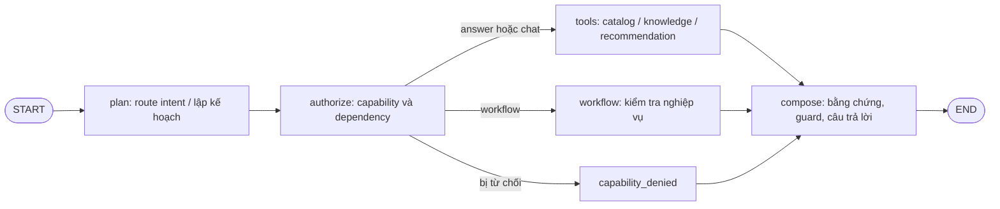

# Smart Merchant Hub — LangGraph AI Sales Brain Overhaul

**Kết quả bàn giao offline — 2026-11-06**

## Phạm vi và tính toàn vẹn

- Repository: `C:\Users\Administrator\Documents\Codex\2026-09-03\referenced-chatgpt-conversation-this-is-an\work\smart-merchant-hub`
- Branch: `codex/rag-rfm-all-updates-20261104`
- HEAD khi xác minh: `92ae7e34c532d3d5b331e3c7343dcd9a20375f61`
- Working tree vốn đã có 174 mục chưa commit trước khi tạo báo cáo; giữ nguyên các thay đổi đó. Không reset, clean, stash, commit, push, migrate hay deploy.
- `git diff --check`: PASS. Git có cảnh báo chuẩn hóa LF/CRLF trên một số file; không có whitespace error.
- Test chạy bằng `backend/.venv`, `RUN_POSTGRES_TESTS=0`, `SALES_JOURNEY_ENGINE_ENABLED=false`; các biến khóa provider được đặt rỗng. Không truy cập `backend/test.db`, database production hay gọi Groq/Gemini/vision provider. Không có token provider phát sinh.

## Kiến trúc graph được giữ và điều chỉnh

Graph hiện tại tiếp tục dùng LangGraph; không thay bằng chuỗi if/else mới hoặc viết lại toàn bộ chatbot.



`TurnState` mang câu hỏi, history, memory, trạng thái collection, ý định catalog, context ngành, capability authorization, tool plan, evidence, citations, recommendation và metadata trả lời. Authorization chạy trước catalog/tool execution; quyền bị tắt hoặc cấu hình lỗi tiếp tục fail-closed.

Luồng retrieval/answer giữ nguyên phân công dữ liệu: giá, tồn kho, trạng thái bán và ứng viên sản phẩm đọc từ catalog tenant hiện hành; knowledge retrieval cấp nguồn văn bản/chính sách; bước compose kiểm tra nguồn/citation và chỉ dùng dữ kiện được cung cấp. Catalog recommendation được xếp hạng rồi render bằng dữ liệu hiện hành, không gọi thêm LLM chỉ để diễn đạt lại giá/tồn.

## Đã triển khai hoặc củng cố

1. **Intent và routing:** câu hỏi thanh toán chuyển khoản được nhận dạng là câu hỏi chính sách và lấy cấu hình hiện hành qua knowledge; tránh bị mẫu “shop có … không” kéo nhầm sang tìm sản phẩm. Câu hỏi so sánh/catalog cụ thể vẫn đi shortcut catalog.
2. **Hỏi làm rõ:** khi yêu cầu tư vấn chung thiếu thông tin thiết yếu, graph hỏi một câu cần thiết trước khi gọi recommendation. Không áp dụng cổng này lên truy vấn có đối tượng và dữ kiện catalog cụ thể.
3. **Đa ý và an toàn dữ liệu:** capability được ghi trong state; OCR observation không điều khiển intent, chỉ được đưa vào làm bằng chứng không xác minh. Mọi lookup vẫn giới hạn theo shop.
4. **Câu trả lời sản phẩm:** lọc phần metadata nhập liệu mang tính kỹ thuật/nội bộ khỏi bản trả lời chi tiết khi không giúp khách quyết định, giữ dữ kiện hữu ích từ catalog.
5. **Ảnh và vision offline:** đường khớp ảnh giới hạn tối đa hai ảnh, cache phân vùng theo shop/model, ứng viên tra lại từ catalog tenant, SKU phải khớp hiện hành; ảnh mờ, không chắc hoặc provider lỗi không tự đoán sản phẩm. `RAG_IMAGE_CATALOG_MATCH_ENABLED` mặc định `False`.
6. **RFM/recommendation:** graph gọi recommendation service với candidate/evidence từ retrieval và dữ liệu catalog hiện hành. Offline synthetic coverage kiểm tra khách mới, khách có consent, chưa consent, đã rút consent, giới hạn ngân sách và cách ly shop. Đây là xếp hạng gợi ý, không dùng RFM để chọn nguồn trả lời kiến thức.
7. **Cờ triển khai:** `SALES_JOURNEY_ENGINE_ENABLED=False` và vision matching OFF theo mặc định.

### Hành vi regression được xác nhận

| Ca | Trước | Sau |
| --- | --- | --- |
| “Shop có hỗ trợ chuyển khoản không?” | Đi nhầm product lookup, thiếu cấu hình thanh toán trong evidence | Route knowledge và dùng cấu hình chuyển khoản của shop |
| “Tư vấn laptop giúp mình” khi chưa nêu nhu cầu thiết yếu | Route recommendation ngay | Hỏi một thông tin còn thiếu trước |
| So sánh hai sản phẩm đã nêu rõ, có giá/tồn | Có nguy cơ bị câu hỏi discovery chung chặn | Vẫn dùng shortcut catalog so sánh |
| Gợi ý trong ngân sách với catalog synthetic | Có thể lạc sang nội dung tương thích xe | Trả kết quả từ ứng viên phù hợp ngân sách, không khẳng định tương thích chưa có nguồn |

Đây là bằng chứng routing/contract offline, **không phải phép đo tổng quát cho độ đúng câu trả lời của LLM**.

## Kiểm thử

Lệnh full backend cuối cùng (chạy từ `backend`):

```powershell
$env:RUN_POSTGRES_TESTS='0'
$env:SALES_JOURNEY_ENGINE_ENABLED='false'
$env:GROQ_API_KEY=''; $env:OPENAI_API_KEY=''; $env:GOOGLE_API_KEY=''
$env:GEMINI_API_KEY=''; $env:ANTHROPIC_API_KEY=''
.\.venv\Scripts\python.exe -m pytest -q tests
```

**Kết quả cuối:** `2286 passed, 3 skipped, 39 warnings, 37 subtests passed in 154.99s`.

Nhóm regression cuối: 4 ca payment route, deterministic recommendation, clarification priority và explicit catalog comparison đều PASS. Một full run trước đó phát hiện 3 lỗi: policy thanh toán bị route sai, kỳ vọng test cũ về LLM call sau deterministic recommendation, và thứ tự clarification/catalog comparison. Đã sửa route và cập nhật assertion tương ứng; full run sau sửa đạt kết quả nêu trên. Các warning còn lại là deprecation/adapter warnings, không làm suite thất bại.

Frontend không chạy lại trong lượt này vì các sửa đổi cuối chỉ thuộc backend; browser UI chưa được mở để kiểm tra runtime.

## Files liên quan trong working tree

Working tree chứa nhiều thay đổi kế thừa chưa commit; danh sách dưới đây là những phần liên quan trực tiếp tới graph/RAG/vision/RFM, không khẳng định tất cả đều được tạo trong lượt cuối:

- `backend/app/services/conversation_graph.py`
- `backend/app/services/auto_reply_service.py`
- `backend/app/services/conversation_context.py`
- `backend/app/services/conversation_memory.py`
- `backend/app/services/capability_registry.py`
- `backend/app/services/image_observation_cache.py`
- `backend/app/services/universal_sales_brain.py`
- `backend/app/rag/serving.py`, `retriever.py`, `answer_guard.py`, `output_contracts.py`, `claim_verification.py`, `industry_glossary.py`, `turn_budget.py`
- `backend/tests/test_conversation_graph.py`, `test_business_request.py`, `test_conversation_context.py`, `test_universal_sales_brain.py`, cùng các contract/regression tests về capability, RAG, vision và provider.
- Báo cáo này: `reports/SMART_MERCHANT_HUB_LANGGRAPH_AI_OVERHAUL_FINAL.md`.

## Trạng thái nghiệm thu

`LANGGRAPH_ARCHITECTURE=IMPLEMENTED_AND_OFFLINE_TESTED`

`INTENT_UNDERSTANDING=ROUTING_REGRESSIONS_TESTED; GENERAL_ACCURACY_NOT_BENCHMARKED`

`MULTI_INTENT_ROUTING=IMPLEMENTED; OFFLINE_TESTED`

`CONVERSATION_MEMORY=IMPLEMENTED; CONSENT_RACE_P2_OPEN`

`RAG_GROUNDING=OFFLINE_CONTRACTS_TESTED; LIVE_ANSWER_GROUNDING_NOT_MEASURED`

`NATURAL_ANSWER_QUALITY=PARTIAL_OFFLINE_ONLY; HUMAN_OR_LIVE_MODEL_SCORE_NOT_MEASURED`

`IMAGE_ATTACHMENT_INGESTION=OFFLINE_TESTED; CHANNEL_RUNTIME_NOT_VERIFIED`

`VISION_MODEL_INTEGRATION=CODE_PATH_AND_MOCK_CONTRACT_TESTED; LIVE_PROVIDER_NOT_TESTED; FLAG_OFF`

`IMAGE_TO_CATALOG_MATCHING=OFFLINE_TENANT_AND_VARIANT_CONTRACT_TESTED; LIVE_MATCHING_NOT_VERIFIED`

`MULTIMODAL_CONVERSATION=OFFLINE_PATH_TESTED; LIVE_ACCEPTANCE_NOT_MEASURED`

`RFM_PERSONALIZATION=SYNTHETIC_OFFLINE_CASES_TESTED_WITH_CONSENT_GATES`

`RAG_RFM_RECOMMENDATION=GRAPH_TO_RANKER_PATH_TESTED_OFFLINE; REAL_SHOP_QUALITY_NOT_MEASURED`

`CONSENT_ENFORCEMENT=OFFLINE_TESTS_PASS; CONCURRENT_REVOCATION_NOT_VERIFIED`

`PROVIDER_RELIABILITY=OFFLINE_FAILURE_CONTRACTS_TESTED; NO_LIVE_PROVIDER_CALLS`

`GRAPH_RECOVERY=OFFLINE_FALLBACK_AND_STRUCTURED_OUTPUT_TESTS_PASS`

`OFFLINE_ACCEPTANCE=PASS — BACKEND 2286 PASSED, 3 SKIPPED`

`LIVE_TEXT_ACCEPTANCE=NOT_RUN — NO PROVIDER CALLS MADE IN THIS RUN`

`LIVE_VISION_ACCEPTANCE=NOT_RUN — VISION FLAG OFF AND NO PROVIDER CALL`

`BACKEND_REGRESSION=PASS — 2286 PASSED, 3 SKIPPED, 39 WARNINGS, 37 SUBTESTS`

`CONSENT_RACE_P2=OPEN`

`POSTGRESQL_RUNTIME=NOT_VERIFIED — POSTGRES TESTS DISABLED`

`PRODUCTION_READY=NO`

`REMAINING_BLOCKERS=LIVE_TEXT/VISION ACCEPTANCE; HUMAN ANSWER-QUALITY REVIEW; POSTGRESQL CONCURRENCY/ISOLATION VERIFICATION; CONSENT-RACE P2; BROWSER RUNTIME; PRODUCTION DATA/SNAPSHOT ACCEPTANCE`

**Kết luận:** LangGraph routing và các regression mục tiêu đã được củng cố, full backend offline pass. Chưa có căn cứ để nói chất lượng trả lời thực tế hoặc nhận diện ảnh đã tốt hơn với model đang chạy; chưa được nghiệm thu PostgreSQL, kênh chat thật hoặc production. Không bật feature flag.
